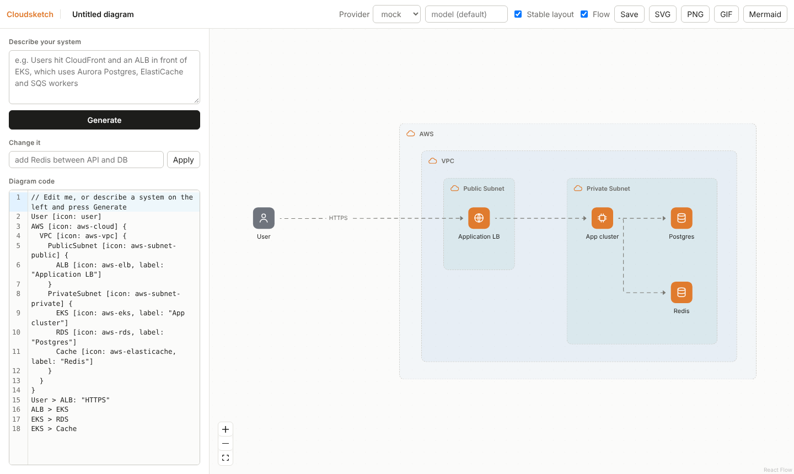

# Cloudsketch — sketch cloud architecture from plain English (research prototype)

Describe a system in plain English and get a clean, editable architecture diagram,
in the spirit of Eraser.io. Built for experimenting with **how well LLMs write
diagram code**, not for production.



## How it works

```
prompt ─► FastAPI ─► LLM (Claude / OpenAI / Ollama / mock)
                      │  system prompt = DSL grammar + icon list + 4 few-shot examples
                      ▼
                   DSL text ─► parser sidecar (Peggy) ──✗──► error sent back to LLM once
                      │                 ✓
                      ▼
                validate (unknown icons, duplicates, undeclared nodes)
                      │
                      ├─► Postgres: generation_logs (every call, for research)
                      ▼
browser: DSL editor ─► same Peggy parser ─► ELK.js layout ─► React Flow canvas
```

The key idea: **the model never draws.** It writes a small text DSL; a deterministic
parser, ELK.js layout engine and a strict theme turn that into the picture. That is
what keeps output clean and consistent across models.

| Folder | What's in it |
|---|---|
| `grammar/` | `diagram.peggy` (the DSL grammar), unit tests, and a tiny Node HTTP sidecar exposing `POST /parse` |
| `backend/` | FastAPI: provider interface (`app/llm/`), prompts + icon registry (`app/prompts/`), pipeline with self-correction (`pipeline.py`), validator, Postgres models |
| `frontend/` | React + TS (Vite): React Flow canvas, ELK layout with stable re-layout, CodeMirror DSL editor, flowing-arrow animation, SVG/PNG/GIF/Mermaid export |
| `eval/` | 20 benchmark prompts and `run_eval.py` |

### Why a parser sidecar?
The grammar is written once in Peggy (JavaScript). The browser uses it for instant
feedback while you type; the Python backend calls the same compiled parser over HTTP
for the self-correction loop. One grammar, identical results on both sides.

## Quick start (Docker)

```bash
cp .env.example .env          # add ANTHROPIC_API_KEY (or set LLM_PROVIDER=mock)
docker compose up --build
```

Open http://localhost:5173. API docs: http://localhost:8000/docs.

No API key? Set `LLM_PROVIDER=mock`. The mock provider builds a naive diagram
from keywords so you can try the whole pipeline offline; it also serves as the
baseline in evals.

## Local development (no Docker)

```bash
# 1. parser sidecar
cd grammar && npm install && npm run build && npm start        # :7070

# 2. backend (SQLite is used if DATABASE_URL is unset)
cd backend && pip install -r requirements.txt
cp ../.env.example .env && uvicorn app.main:app --reload       # :8000

# 3. frontend
cd frontend && npm install && npm run dev                      # :5173, proxies /api
```

Tests: `cd grammar && npm test` (parser) and `cd backend && pytest` (validator).

## Swapping LLM providers

All providers implement one method (`backend/app/llm/base.py`):

```python
class LLMProvider(Protocol):
    name: str
    model: str
    def complete(self, system: str, messages: list[Message]) -> Completion: ...
```

- **Default for the whole app:** `LLM_PROVIDER` and `LLM_MODEL` in `.env`
- **Per request:** the Provider dropdown and model box in the top bar, or `provider` / `model` in the API body
- **Local models:** install [Ollama](https://ollama.com), `ollama pull qwen2.5-coder:7b`, choose `ollama`
- **Add a provider:** write a class like `app/llm/ollama.py` and register it in `PROVIDERS` in `app/llm/__init__.py`

| Provider | Default model | Needs |
|---|---|---|
| `claude` (default) | `claude-sonnet-5-5` | `ANTHROPIC_API_KEY` |
| `openai` | `gpt-4.1` | `OPENAI_API_KEY` |
| `ollama` | `qwen2.5-coder:7b` | Ollama running locally |
| `mock` | keyword baseline | nothing |

The models return plain DSL text rather than JSON tool calls. A DSL is shorter and
easier for models to write than an equivalent JSON graph, and parse errors give exact
line/column feedback for the retry. Comparing this against a JSON-schema variant is a
good first experiment.

## The DSL

```
// comments
User [icon: user]
AWS [icon: aws-cloud] {                 // group (nestable)
  VPC [icon: aws-vpc] {
    EKS [icon: aws-eks, label: "App cluster"]
    RDS [icon: aws-rds, label: "Postgres"]
  }
}
User > EKS: "HTTPS"                     // labelled edge
EKS > RDS                               // also <, <>, - and chains: A > B > C
```

Validation never blocks rendering. It repairs and reports:

| Issue | Behaviour |
|---|---|
| Unknown icon | replaced with `generic-service`, warning |
| Duplicate name | later one dropped, warning |
| Edge to undeclared name | node auto-created (shown in italics), warning |
| Self-loop | dropped, warning |
| Syntax error | backend: one LLM self-correction pass. Editor: last valid diagram stays on screen |

## Icons

Icon keys live in `backend/app/prompts/icons.json` (72 keys across AWS, GCP, Azure and
generic). The same list feeds the LLM prompt, the validator and the frontend.

Official icon packs aren't bundled (each vendor has its own terms). Download them,
then import:

```bash
cd frontend
node scripts/import-icons.mjs aws   ~/Downloads/Asset-Package-AWS
node scripts/import-icons.mjs azure ~/Downloads/Azure_Public_Service_Icons
node scripts/import-icons.mjs gcp   ~/Downloads/google-cloud-icons
```

This copies matches into `public/icons/<key>.svg` and lists anything unmatched (add an
alias in the script). Until then, nodes render as provider-coloured tiles with a
category glyph, as in the screenshot.

## Flow animation and GIF export

The **Flow** toggle in the top bar animates every arrow with dashes marching from
source to target, the "flowing" style common in architecture posts. **GIF** exports
an animated, looping GIF of the whole diagram:

- 14 frames at 60 ms, one 14px dash period, so the last frame flows straight into the first with no jump
- one shared 256-colour palette across frames, which avoids colour flicker
- 1:1 scale, about 270 KB for the sample diagram; the button shows progress while frames render
- uses the current theme (light or dark follows your OS setting)

The GIF is always animated, even with the Flow toggle off. Tuning lives in
`frontend/src/export/export.ts` (`DASH`, `DASH_PERIOD`, `GIF_FRAME_MS`) and the matching
`flow` keyframes in `index.css`. The live animation respects `prefers-reduced-motion`.

## Research features

**Edit mode.** "Change it" sends the current DSL plus your request, so the model edits
instead of regenerating. The prompt asks it to keep names and order.

**Stable layout** (top-bar toggle). On edits, ELK starts from the previous positions and
uses semi-interactive crossing minimisation, so existing nodes keep their order. Nodes
you drag are pinned; their edges switch from ELK routes to smoothstep. Turn it off to
compare against a full re-layout.

**Generation logs.** Every `/api/generate` and `/api/edit` call writes a row to
`generation_logs`: provider, model, prompt, every raw output (including the retry), final
DSL, parse success first/final, attempts, node count, unknown-icon count, latency and
tokens. Browse with `GET /api/logs?tag=...` or SQL:

```sql
SELECT provider, model,
       avg(parse_ok_first::int) AS first_try_ok,
       avg(unknown_icon_count::float / nullif(node_count, 0)) AS unknown_icon_rate,
       avg(latency_ms) AS avg_ms
FROM generation_logs GROUP BY 1, 2;
```

**Evaluation.**

```bash
python eval/run_eval.py --provider claude
python eval/run_eval.py --provider ollama --model llama3.1:8b
python eval/run_eval.py --provider mock          # baseline
```

Reports first-try and final parse success, unknown-icon rate, expected-icon recall (each
prompt lists the icons a good answer should use), and average / median latency. Results
are saved to `eval/results/` and rows are tagged in Postgres with the run id.
Mock baseline: 100% parse, 0% unknown icons, 27.9% expected-icon recall.

## Ideas to explore next
- DSL vs JSON vs Mermaid as the LLM output format (measure parse and recall)
- Few-shot count and example selection (retrieve examples similar to the prompt)
- Diff-based edits instead of returning the full DSL
- Reverse direction: Terraform plan or K8s manifests → DSL
- Layout quality metrics: edge crossings, total edge length, label overlap
- Fine-tune a small model on prompt → DSL pairs from the logs

## Known limitations
- No auth, rate limiting or multi-user handling (research only)
- Only one self-correction attempt; semantic errors (wrong architecture) aren't caught
- Frontend bundle is ~2 MB because `elkjs` is bundled; move ELK to a web worker for large diagrams
- Stable layout reduces reshuffles but cannot guarantee zero movement when the graph structure changes a lot
